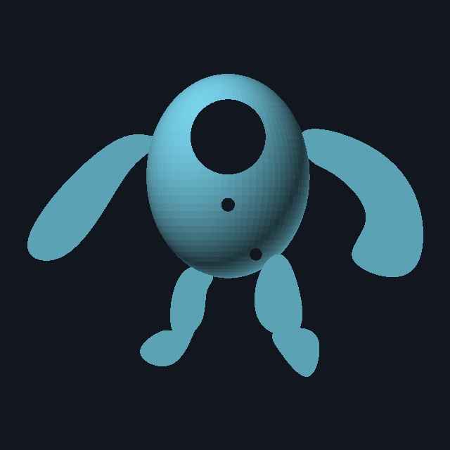
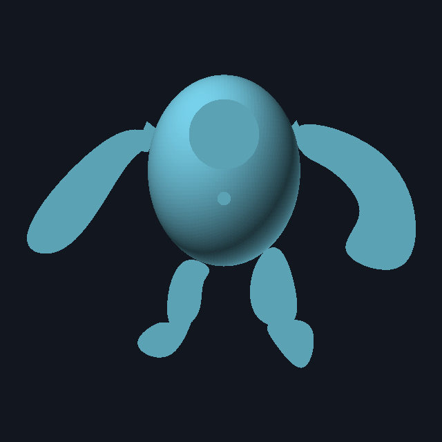

# Nouri figure: print-ready rebuild

Rebuilt from `Part Studio 1 - Part 1.stl` (Onshape export). Your character's shape, proportions and
limb outlines are kept; the geometry is fixed and split into parts that print without supports on
any visible surface.

| Original | Rebuild |
|---|---|
|  |  |

## What was wrong (measured from your file)

| Problem | Measured | Fix |
|---|---|---|
| Exported in **metres** | Slicers would show a 0.29 × 0.22 × 0.13 mm speck | Everything here is in mm |
| One huge part | 290.6 × 222.4 × 134.4 mm. Doesn't fit most beds; only 6.9 cm² touching the bed; 193 cm² of overhang | Split into 4 parts, each ≤ 219 mm, three of them flat |
| Feet extruded far too deep | Left foot z −69 → +31.5 (100 mm), right foot z −52.5 → +65 (117 mm) | Feet are part of the flat 5 mm back plate |
| Limbs at different depths | Right arm z −6…−0.5, left arm z +5.5…+11, right leg z +18.5…+25, left leg z −6…−0.5 | All limbs in one plane, 5 mm thick |
| Screw bosses unusable | ⌀9 mm holes in ⌀10 mm bosses (0.5 mm walls); one boss ⌀8.35 *smaller* than its hole; bosses hang 4–5 mm below the rim | 4 × ⌀8 mm bosses fused to the shell wall, ⌀4.2 × 6.5 mm holes for M3 heat-set inserts |
| Bosses not symmetric | x = +20.4 / −11.9 (bottom), −16.2 / +17.4 (top) | (±14, ±58) |
| Stray hole through the face | A boss hole cut "through all" at (20.4, −57.5) | Removed |
| Total material | 499 cm³ solid | 182 cm³ solid (about 150 g of PLA at normal settings, a rough estimate) |

Kept from your design: egg body 114 × 143 mm with a 58 mm dome, display window ⌀52.5 mm at (0, +27),
sensor hole ⌀10 mm at (0, −21), and the exact arm/leg/foot outlines (`outlines.json`).

## Parts (`print/`)

| File | Size (mm) | Orientation | Supports |
|---|---|---|---|
| `front-shell.stl` | 114 × 143 × 58 | Rim on the bed, dome up | **Tree supports, "build plate only"**: they only grow inside the dome, so the outside stays clean |
| `back-plate.stl` | 131.7 × 218.9 × 5 | Flat, as exported (countersinks face the bed) | None |
| `arm-left.stl` | 107 × 99 × 5 | Flat | None |
| `arm-right.stl` | 104 × 112 × 5 | Flat | None |

The back plate is 218.9 mm long: fine on 220+ beds (rotate it 45° on a 220 × 220 bed for brim room).
It won't fit a 180 mm bed (e.g. Bambu A1 mini). Tell me your printer and I can split it.

### Suggested settings (PLA or PETG, 0.4 mm nozzle)

- Layer height 0.2 mm; 3 walls; 15–20% gyroid infill; 4 top / 4 bottom layers
- Shell: brim off (the rim is wide enough); tree supports, build plate only, 3 mm interface gap
- Plates: 0.2 mm first layer, no brim needed; a brim helps on PETG if corners lift
- Holes are drawn at nominal size. If the dovetails are too tight on your printer, increase
  `dovetail.clearance` (0.2 → 0.3) and rebuild.

## Hardware & assembly

- 4 × M3 heat-set inserts (⌀4–4.2 mm outside, up to 6 mm long)
- 4 × M3 × 10 mm countersunk (flat-head) screws

1. Press the inserts into the four bosses inside the shell with a soldering iron (about 220 °C for PLA).
2. Click each arm's dovetail into its notch in the back plate (a drop of glue makes it permanent).
3. Put the electronics in the shell, lay it on the plate (the rim also covers the arm joints), and screw from the back.

## Changing the design

All dimensions are named at the top of `generate.mjs` (`P = { ... }`), e.g. wall thickness, window
size and position, boss positions, insert size, plate thickness, dovetail fit.

```bash
cd hardware/figure
npm install
npm run build
```

New STLs appear in `print/`, plus `preview/assembled.stl` (assembled preview, not for printing) and
`preview/summary.json`.

## If you'd rather fix it in Onshape

The rebuild imports into Onshape only as a mesh (not editable). To fix your own Part Studio instead:

1. **Export units:** in the STL export dialog choose **Millimeter**.
2. **Feet:** edit both foot extrudes → **Blind**, 5 mm, same direction as the legs.
3. **Limbs:** put every arm/leg sketch on the same plane (the rim plane) and extrude each **Blind 5 mm** in
   the same direction. Use **New** (separate parts) instead of **Add** so they print flat.
4. **Bosses:** sketch circles ⌀8 at (±14, ±58); extrude **Up to part** (the shell); hole ⌀4.2, 6.5 mm deep.
5. **Stray face hole:** change the boss-hole extrude from *Through all* to **Blind 6.5 mm**.
6. Add a back plate: an offset of the egg outline, 5 mm, with ⌀3.4 countersunk holes at the boss positions.
