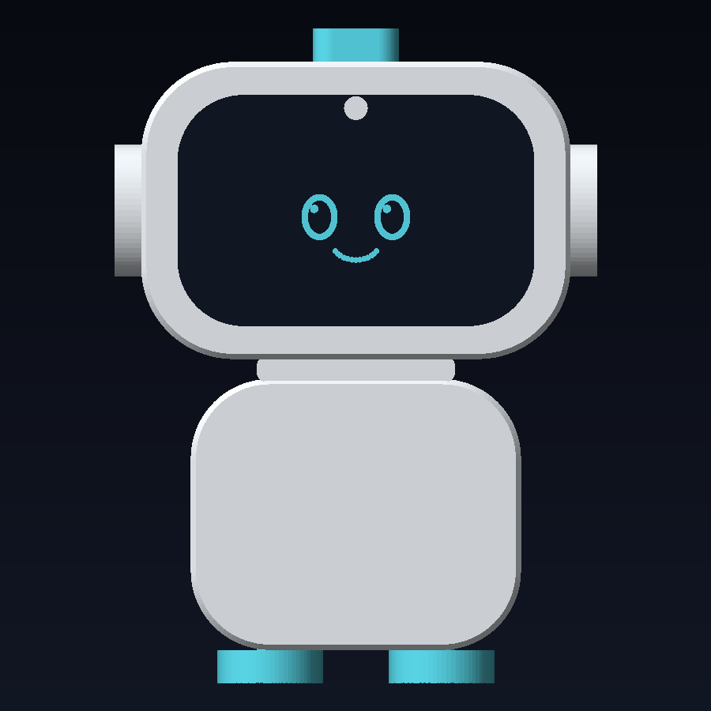
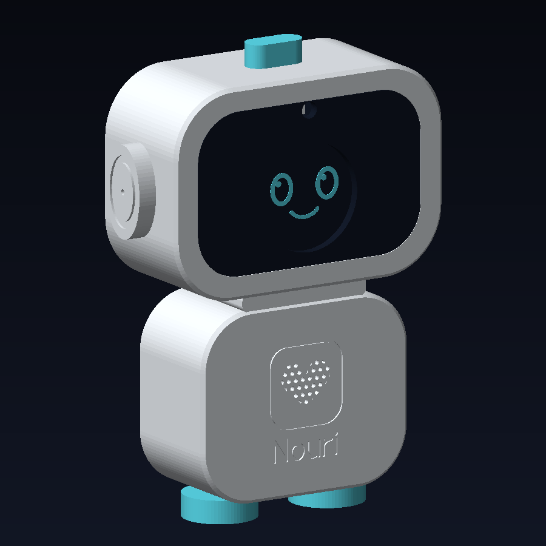
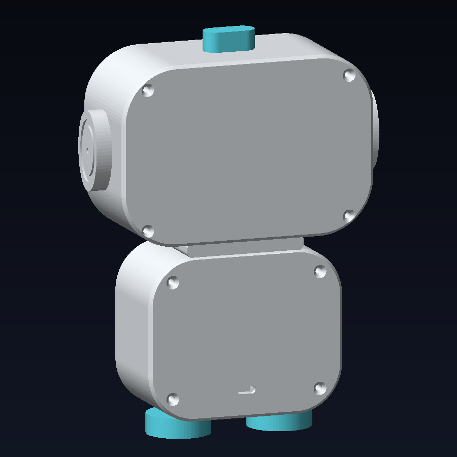
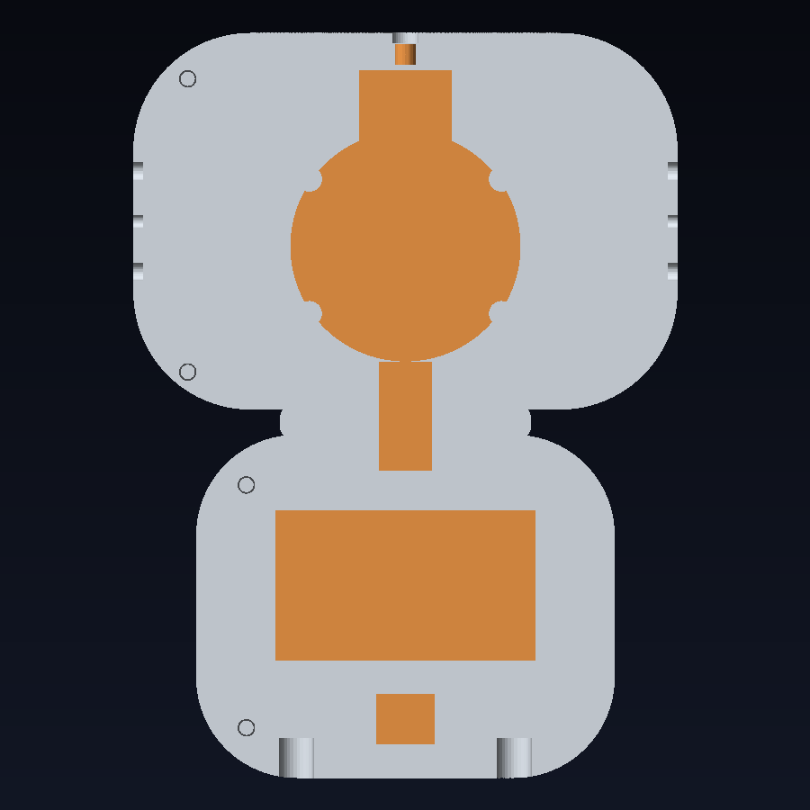
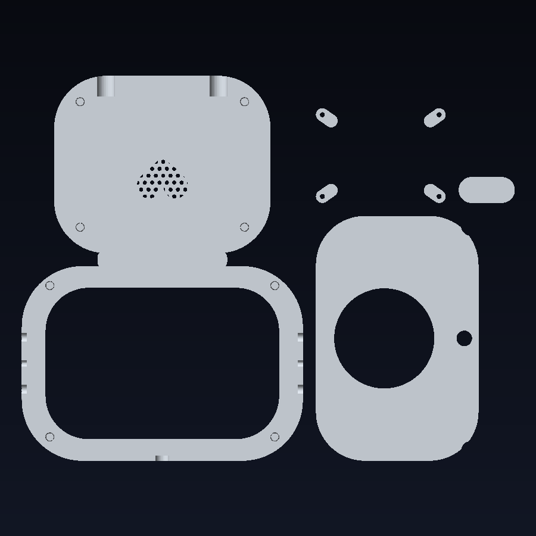
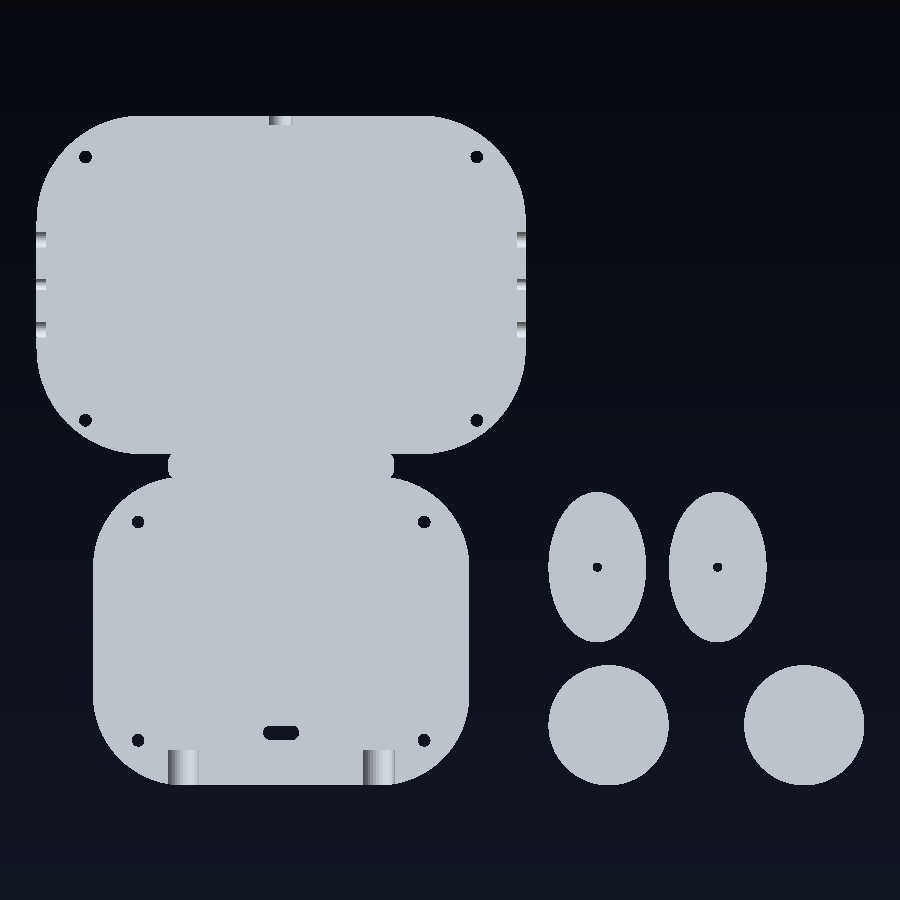

# Nouri robot: print-ready enclosure

The physical Nouri from the website intro, built around the **Waveshare ESP32-S3-Touch-LCD-1.85**
(the round face). Every part prints without supports, and `generate.mjs` checks that every
component fits before writing files.

| Front | Angle | Back | Inside (from behind) |
|---|---|---|---|
|  |  |  |  |

**Assembled size:** 146 × 198 × 56 mm (W × H × D, including ears, antenna and feet).
The eyes and smile in the previews show the round display; they're not printed.

## The face: ESP32-S3-Touch-LCD-1.85 (enclosed version)

Built for the unit **in Waveshare's round case**:

| | mm |
|---|---|
| Case footprint | 55.0 × 55.0 → modelled as a ⌀55 round puck |
| Case thickness | 14.6 |
| Visible screen | ⌀45.68 (1.85″, 360 × 360) → round window in the visor |
| USB-C opening | bottom edge, assumed 8.5 from the case front (`HW.display.case.usbZ`) |

This board already has the **ESP32-S3, microphone, speaker amplifier (PCM5101), battery charger,
TF slot and IMU**, so there's no separate ESP32, amplifier or mic board.

**How it's held:** the case drops face-down into a ⌀55.5 ring on the back of the black visor (the ring
has a gap at the bottom for the USB-C plug). Four small **display tabs** screw onto posts and press the
back edge of the case, so nothing presses on the electronics.

**If your case is square, not round:** tell me (or change `disc(...)` for the case to a rounded square in
`generate.mjs`). **Using the bare board without its case?** Set `HW.display.mode = "bare"`; the bare-board
numbers from Waveshare's drawing (glass ⌀48.08, board ⌀47.86) are still in `HW.display`.

**USB-C:** the plug hangs straight down from the bottom of the display, through the neck. Use a
**panel-mount USB-C extension** from there to the slot in the back of the body, so you can charge and
reprogram without opening Nouri.

## Camera

Waveshare's FAQ says this board **can't connect a camera**. So the lens hole at the top of the visor has a
pocket for a separate **Seeed XIAO ESP32-S3 Sense** (OV2640 camera, about 22 × 18 × 16 mm with its camera
board), mounted right behind the hole. It runs the camera and talks to the main board over Wi-Fi or UART.
If you skip the camera, leave the hole or plug it.

## Other parts

| Part | Assumed | Where | Parameter |
|---|---|---|---|
| Speaker | "2030" 8 Ω 2 W (30 × 20 × 5 mm), plugs into the board's SPK connector | Frame behind the heart grille | `HW.speaker` |
| Antenna light | 5 mm LED or through-hole WS2812 on a spare GPIO | Inside the translucent antenna | `HW.led` |
| Battery (optional) | 3.7 V LiPo up to 62 × 36 × 11 mm, MX1.25 plug | Back of the body | `HW.battery` |
| USB-C | Panel-mount extension 14 × 12 mm | Slot low on the back | `HW.usbc` |

The ears have vent holes so the board's onboard microphone can hear clearly.

## Fit check (current numbers)

```
✓ display  ✓ usb plug  ✓ camera  ✓ camera board
✓ speaker  ✓ led  ✓ battery  ✓ usb-c port
```

Each component's space is tested against every printed part and every other component.

## Print it in two jobs (Bambu A1 / P1 / X1, 256 × 256 mm bed)

| File | What's on the plate | Uses |
|---|---|---|
| **`print/Nouri-FRONT.3mf`** | front shell · visor (black) · antenna · 4 display tabs | 234 × 184 mm |
| **`print/Nouri-BACK.3mf`** | back shell · 2 ears · 2 feet | 226 × 184 mm |

| Front plate | Back plate |
|---|---|
|  |  |

Open each `.3mf` in **Bambu Studio** (File → Import). Every part is its own object, already laid flat,
so you can:

- **With an AMS:** click an object and pick its filament: visor **black**, antenna **translucent**,
  feet **cyan**, everything else white.
- **Single colour:** print everything white and paint the visor, or print just the visor again in black
  from `print/single-parts/`.

No supports anywhere: walls are vertical when printed, edges have 45° chamfers, and the visor's 2.6 mm
flange is a short overhang that prints fine. The same plates are also included as `Nouri-FRONT.stl` /
`Nouri-BACK.stl` (one merged object each) for other slicers.

### Separate parts (`print/single-parts/`)

| File | Size (mm) | Colour | On the bed |
|---|---|---|---|
| `front-shell.stl` | 130 × 178 × 28 | White | Face down |
| `back-shell.stl` | 130 × 178 × 28 | White | Back down |
| `visor-bezel.stl` | 113 × 75 × 19 | **Black** | Face down |
| `display-tabs.stl` | 4 small tabs | Any | Flat |
| `ear-left.stl`, `ear-right.stl` | 26 × 40 × 10 | White (fill the ring groove with cyan paint) | Outer face down |
| `antenna.stl` | 26 × 12 × 18 | **Translucent** white/cyan PETG, so the LED glows | Top down |
| `feet.stl` | 84 × 32 × 19 | Cyan | Flat, pegs up |

On a smaller printer (e.g. Bambu A1 mini, 180 mm), print these one at a time.

**Settings (PLA, 0.4 mm nozzle):** 0.2 mm layers, 3 walls, 15% gyroid infill, 4 top/bottom layers.

## Hardware to buy

- Waveshare ESP32-S3-Touch-LCD-1.85
- 2030 speaker, 8 Ω 2 W (with the matching connector for the board's SPK port)
- Seeed XIAO ESP32-S3 Sense (only if you want the camera)
- Panel-mount USB-C extension cable (male to female), about 15–20 cm
- 8 × M3 heat-set inserts (⌀4–4.2 mm, up to 7 mm long) + 8 × M3 × 30 mm countersunk screws
- 4 × M2 × 6 mm self-tapping screws (display tabs)
- CA or hot glue; optional LiPo with MX1.25 plug; optional 5 mm LED / WS2812

## Assembly

1. Press the 8 inserts into the bosses of the **front shell** (soldering iron, ~220 °C for PLA).
2. Lay the **visor bezel** face-down. Drop the cased display in face-down so it sits in the round ring,
   USB-C at the bottom gap. Screw on the four **display tabs** (M2) so they press the back edge of the case.
3. Push the **XIAO camera** into the holder above the display (lens through the hole).
4. Glue the bezel into the face opening from inside (CA glue on the flange).
5. Glue the **speaker** into its frame behind the heart and plug it into the board's SPK connector.
6. Plug the **USB-C extension** into the display, run it down through the neck and fix the socket in the
   back slot. Add the battery if you use one.
7. Feed the LED wires through the top hole and glue on the **antenna**; glue on the **ears** and **feet**.
8. Close the shells and screw them together from the back (8 × M3 × 30).

## Changing the design

```bash
cd hardware/nouri-robot
npm install
npm run build
```

- `HW` = your parts. `S` = the character's proportions (head, visor, body, ears, antenna, feet, wall).
- If something no longer fits, the build prints `✗ … collides with …` and exits with an error.
- `preview/report.json` lists every part, size and fit result.
